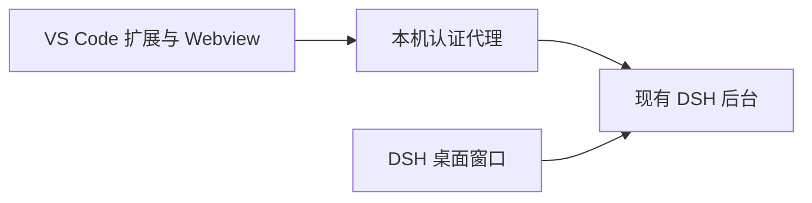

# DSH Companion

把现有 DeepSeek Harness 接入 VS Code：在右侧聊天栏使用 DSH，并自动关联当前工作区、文件和代码选区。

An experimental VS Code integration for an existing DeepSeek Harness installation, with a themed sidebar and automatic workspace and editor context.

> **当前状态：0.2.0 实验版，仅面向 Windows 本地工作区。** 本项目仍需要本机已有的桌面 DSH 安装。没有后台运行时，插件会隐藏启动现有桌面程序，由其原生单实例机制管理后台。**独立于桌面壳的宿主架构尚未实现。**

## 提供什么

- **右侧聊天栏**：从编辑器右上角的鲸鱼图标或命令面板进入，窄侧栏布局及颜色跟随 VS Code 主题。
- **直接可见的入口**：顶部提供会话历史、新会话，以及插件、自动化任务、设置与账号图标。
- **自动工作区绑定**：新会话使用当前工作区；多根工作区跟随当前编辑文件所在目录；历史会话保留自己的工作目录。
- **自动代码引用**：当前文件以紧凑标签显示，选中代码时优先引用选区并显示行号。点击 × 取消后，同一上下文的普通编辑不会立即把引用加回；切换文件或选区后可重新自动引用。
- **保留编辑内容**：选区使用当时的缓冲区快照；整文件引用在发送时读取最新缓冲区，包括未保存内容。保留手动引用和已输入文字，并配合 DSH 的发送失败草稿恢复。
- **复用现有后台**：沿用桌面 DSH 的配置、模型、插件和历史，不下载第二套运行时，不修改桌面应用文件。
- **数字鲸鱼加载页**：固定轮廓、内部数字滚动，颜色跟随主题，并支持减少动态效果的系统偏好。

本项目提供 VS Code 集成，不包含 DSH 本体，也不提供独立的模型服务。

## 兼容范围

| 项目 | 声明或已验证范围 |
| --- | --- |
| 操作系统 | Windows 本地工作区；macOS、Linux、SSH 和 WSL 工作区暂不支持 |
| VS Code | 扩展声明最低版本为 `1.106.0`；实际验证版本为 `1.124.2` |
| 桌面 DSH | 当前适配并验证 `0.2.1-rc.2`；其他版本尚未验证 |
| 开发环境 | Node.js 22+、npm |

页面集成依赖 DSH 当前的前端启动协议、插件服务和页面结构，尚不是基于稳定公开嵌入 SDK 的实现。DSH 升级后可能需要重新适配。

## 从源码安装

本项目尚未发布到 VS Code Marketplace，也没有预设可下载的 GitHub Release 安装包。可以在 Windows PowerShell 中构建本地 VSIX：

```powershell
git clone https://github.com/2061623884/dsh-companion.git
Set-Location dsh-companion
npm ci
npm run check
npm test

# 当前打包脚本将 VSIX 输出到仓库同级的 outputs 目录。
New-Item -ItemType Directory -Force ..\outputs | Out-Null
npm run package
```

0.2.0 的输出文件为 `../outputs/dsh-companion-0.2.0.vsix`。在 VS Code 中运行 **Extensions: Install from VSIX...**，选择该文件，按提示重新加载窗口。

当前扩展标识为 `local-development.dsh-companion`。`local-development` 是本地开发发布者标识，不代表已注册的 Marketplace 发布者。

## 使用

1. 确认本机已有桌面 DSH，并已完成账号和模型配置；不必提前打开桌面窗口。
2. 在 VS Code 打开项目，点击编辑器右上角鲸鱼图标，或运行 `DSH Companion: 打开右侧聊天`。
3. 插件自动连接已有后台；没有后台时隐藏启动现有桌面程序，再连接其动态端口。
4. 正常输入消息、检查或取消文件/选区引用后发送。也可以从编辑器右键菜单执行 `DSH Companion: 引用当前文件或选区`。

需要重新探测后台时，点击侧栏标题的刷新图标，或运行 `DSH Companion: 重新连接桌面版`。失败的消息不会由本扩展静默重发；检查草稿后再决定是否重试。

**关闭侧栏或退出 VS Code 不会结束共享 DSH 后台**，以免打断桌面端和后台任务。需要完全退出时，使用桌面 DSH 的正常退出入口；关闭桌面窗口可能只是进入托盘。

### 后台怎样启动与共享



0.2.0 复用现有桌面程序的隐藏启动方式，而不是直接启动一个独立的裸 Host。Windows 命名互斥锁协调多个插件客户端的首次启动；桌面程序自己的单实例机制持有后台。随后正常打开桌面快捷方式，会显示同一实例的窗口。

后台动态端口在连接时探测，健康连接持续复用，不因空闲几秒就重新扫描进程。认证使用现有桌面浏览器会话记录，签名密钥保留在扩展宿主进程中，不交给页面脚本。

### 引用与诊断数据

引用内容会在发送消息时作为上下文交给 DSH 所配置的模型；未保存代码也可能包含在内。发送前请检查引用标签和选区。模型请求、账号和历史仍由现有 DSH 管理，本项目不会将这些数据随源码一起分发。

`dshCompanion.diagnostics` 默认关闭。开启后，可在 VS Code 的 **DSH Companion** 输出通道查看固定阶段名、耗时和字节数；诊断日志不记录代码正文或认证密钥。

## 开发与验证

| 命令 | 用途 |
| --- | --- |
| `npm run check` | TypeScript 类型检查，不生成文件 |
| `npm run build` | 构建扩展宿主、浏览器适配器及测试所需产物 |
| `npm test` | 构建并运行常规自动化测试；不启动真实 DSH 或调用模型 |
| `npm run package` | 检查、构建并打包 VSIX；需先创建上文的输出目录 |

现有自动化测试覆盖引用取消与恢复、选区快照、最新文件缓冲区、待发送状态、手动引用排队、过期页面回复隔离，以及代理的认证、流式转发、失败不重放和重连。

真实 VS Code Webview 和 Windows 桌面启动的验证方法及已记录结果见 [验证说明](docs/validation.md)。`tests/windows-startup.cjs` 是单独运行的实机测试：它会启动已有 DSH 并打开桌面窗口来检查单实例复用，不属于 `npm test`，不要在已有后台运行时随意执行。

源码只跟踪扩展、测试、文档和许可；依赖、构建产物、VSIX、日志和本机测试目录不纳入 Git。

## 架构与当前限制

| 模块 | 职责 |
| --- | --- |
| `src/desktop` | 现有安装的隐藏启动、端口发现、认证和 HTTP/SSE/WebSocket 代理 |
| `src/context` | VS Code 工作区、编辑器焦点、选区及未保存缓冲区 |
| `src/references` | 引用身份、取消和发送生命周期，不依赖 DSH 页面结构 |
| `src/sidebar` | Webview 消息、主题、加载页，以及私有 DSH 页面适配 |

更多设计见 [架构说明](docs/architecture.md) 和 [验收要求](docs/spec.md)。

当前限制：

- 需要现有桌面 DSH 安装；独立运行时/宿主仍待设计与验证，不是当前能力。
- 尚未完成专门的拖拽适配，也未支持远程工作区。
- 启动时账号过期、应用更新弹窗，以及其他 DSH 版本的行为尚未全面验证。
- 已移除健康连接路径上的周期性进程扫描，但完整的原生 VS Code 首次发送卡顿尚未复现；已有耗时数据不代表模型首字延迟或所有环境的性能。

## 许可与来源

本项目从 Vithrive 的 **DeepSeek Harness for VSCode** 定制原型整理而来。侧栏适配器、样式、启动集成及鲸鱼路径包含衍生部分，保留上游 MIT 许可及归属，详见 [LICENSE](LICENSE) 和 [THIRD_PARTY_NOTICES.md](THIRD_PARTY_NOTICES.md)。

DeepSeek 名称和鲸鱼标志属于其权利人；源码许可不授予商标权。本项目与 DeepSeek 官方没有隶属关系。桌面 DSH 的运行时、凭据、账号配置、第三方模型插件和用户会话不包含在本仓库中。
