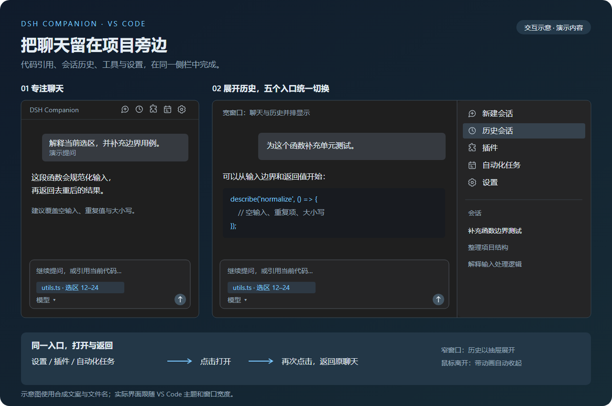

# DSH Companion

在 VS Code 中连接已安装的 DeepSeek Harness 桌面端，使用同一个运行时、登录、配置和会话。

当前源码为 **0.4.0-preview.4 开发预览版**，仅供本地试用；GitHub Release 中的 0.3.10 是此前的独立运行时版本。



## 安装与打开

支持 Windows x64、本机 VS Code 1.106.0 或以上。

1. 安装 [DeepSeek Harness 官方桌面端](https://www.deepseek.com/harness/)。已有桌面端的用户可以直接使用。
2. 在 VS Code 按 `Ctrl+Shift+X`，点击扩展视图右上角的 `…` → **从 VSIX 安装…**。
3. 选择本地预览包 `dsh-companion-0.4.0-preview.4-win32-x64.vsix`，按提示重新加载窗口。
4. 打开代码文件，点击编辑器标题栏右侧的蓝色鲸鱼图标，打开聊天侧栏。也可执行命令 `DSH Companion: 打开右侧聊天`。

插件未发现桌面端时显示“下载桌面端”。原版桌面端已安装但未运行时显示“打开桌面端”，点击后等待其后台就绪并连接。包含配套后台启动补丁、并声明相应能力的 Windows 桌面构建会自动在后台启动；已有后台直接复用。不会另外安装 Node 或 CLI。

配套桌面端补丁及准确源码基线位于 [patches/](patches/README.md)。它需要按上游指南单独构建、安装；本仓库不分发桌面端安装包。

## 共用与更新

插件通过本机认证连接桌面后台。登录、模型配置、插件配置和会话均属于桌面端，插件不再复制它们，也不再启动独立 DSH。桌面端关闭后连接中断；重新运行后可重连。关闭 VS Code 只释放插件连接，不关闭桌面端或中断其任务。

插件激活时及之后每 6 小时检查官方桌面更新源，按已安装桌面端的更新渠道比较版本。有新版时显示提醒和“前往更新”入口，同一版本不反复自动提醒。也可点击侧栏标题栏的更新图标，或运行 `DSH Companion: 检查桌面端更新`。检查失败会在输出中记录；手动检查会明确提示失败，不会显示“已是最新版”。检查只读取本机版本和公开版本元数据，不上传代码、会话或登录信息，也不自动下载安装。

后台启动依赖配套桌面构建提供的能力。若更新后的官方桌面端尚未包含该能力，插件会保留“打开桌面端”入口；不会偷偷覆盖官方程序来维持补丁。

连接中断时保留当前聊天页面和草稿，并显示连接状态；恢复 Host 后由 DSH 自己的连接层恢复会话。已经提交的消息不会由插件自动重发。桌面端升级后，若需要新的界面资源，请保留草稿后显式刷新侧栏。插件的自定义导航、主题和代码引用仍需要与桌面端界面接口兼容，不能保证未来任意版本均无需更新插件。

旧独立版本保存在 VS Code 数据目录中的配置和会话保持原状，本预览不会自动合并或删除它们。首次切换后看到的是桌面端的会话列表。

原版 Desktop 0.2.1-rc.2 仍需桌面端运行。已验证：单独启动 Host 后再打开原版桌面端，会产生第二个 Host。配套源码补丁通过保留桌面外壳、后台启动唯一 Host 来解决这一启动顺序问题，需要新的桌面构建及 Windows 安装验收；不能只更新 Companion 就宣称完成。详见 [问题复现](docs/desktop-host-reuse.md) 和 [源码修复方案](docs/shared-session-solution.md)。

## 导航和代码引用

入口依次为 **历史会话、新建会话、插件、自动化任务、设置**。收起时在右上角横排显示图标；展开历史后，在右侧竖排显示文字入口和会话列表。宽窗口中与聊天并排，窄窗口中以抽屉展开，支持鼠标离开自动收起。

设置、插件和自动化任务再次点击会返回原聊天；新建和历史保持各自行为。

当前文件或代码选区会自动进入输入框，可单独移除；也可通过编辑器右键菜单引用。选区包含尚未保存的编辑内容。新会话关联当前工作区，已有历史保留自己的工作目录。

## 本地开发与验证

```powershell
npm ci
npm run check
npm test
npm run test:desktop
npm run package
npm run check:release
npm run test:release
```

桌面连接集成测试及实际 VSIX 安装验收需要本机已安装官方桌面端。测试使用桌面程序自带的 Host、合成数据目录和隔离的 VS Code 配置，外部模型请求被拦截，不使用日常登录或会话。

最终 VSIX 位于 `.test-work/release/`。打包只收集发布文件，包内包含扩展、界面适配和许可证，排除整个 `runtime/` 目录及测试夹具。`src/desktop/` 负责桌面发现、认证代理和更新检查；旧运行时代码统一放在 `tests/fixtures/legacy-runtime/`，供历史回归使用，不属于产品启动路径。

当前预览以本地验证为准；托管工作流的桌面端准备步骤需要在后续发布前单独配置和验证。

## 数据和反馈

桌面安装路径和本机端口按当前环境识别，不包含开发者账号或机器路径。认证信息只用于本机连接，不写入 VS Code 设置，不随安装包分发。

报告问题时请提供版本、复现步骤和错误代码，并移除个人路径、账号、访问令牌及真实会话内容。

本项目是独立社区项目，采用 [MIT 许可证](LICENSE)。详见 [第三方说明](THIRD_PARTY_NOTICES.md)。
