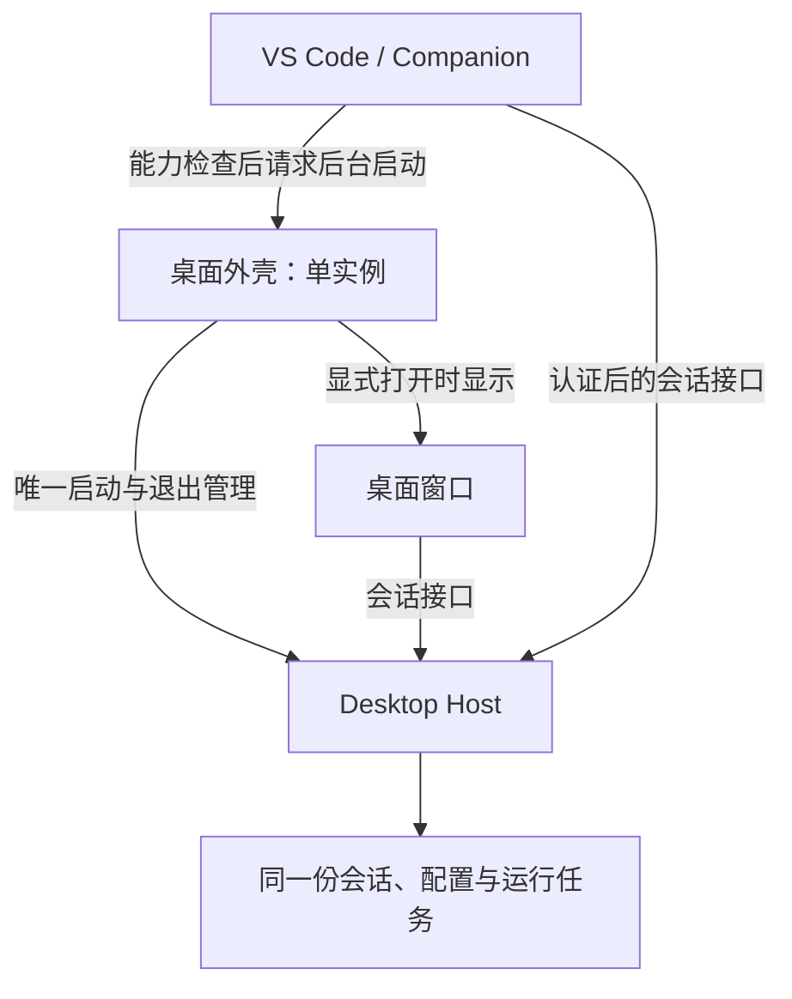

# 共享会话与后台启动：源码修复方案

日期：2026-10-26。交付形式：Companion 源码及 [DSH Desktop 配套补丁](../patches/README.md)。最初验证的官方 Desktop 0.2.1-rc.2 不具备新增的后台启动能力；此后已完成配套 Desktop `0.2.1-rc.3.20261026.1` 的 Windows 构建、本地安装和共享后台验收。当前 Companion 为 `0.4.0-preview.4`，对应安装与布局验证见 [验证记录](validation.md)。

## 采用的方案

保留桌面外壳作为唯一 Host 管理者，新增明确的后台启动模式。Companion 发现已有 Host 时直接连接；未运行时，仅在桌面构建声明支持该能力后，请求桌面外壳后台启动。以后正常打开桌面端，由现有 Electron 单实例机制通知同一外壳显示窗口，继续使用同一 Host。

这里的“后台”指不主动显示普通工作区窗口，Electron 外壳仍运行。首次登录、必要的欢迎流程、强制更新及致命错误仍应显示。它不是一个完全脱离 Electron 的新守护进程。



这条路线保留当前 Host 的父子 IPC、登录状态通知、更新请求锁、退出检查及完整关闭确认。独立启动一个 Node Host 再让原版桌面端启动自己的 Host，仍不能达到上述目标。

## 核查依据

Companion 基线：`19da7cdc8d66b995b134a7f4830fb5704f34c11f`。

DSH 已安装版本对应源码：`dsh-v0.2.1-rc.2` / `687f282e8625c6b8d11ff58211a90524be2e4317`；配套桌面补丁基于当前开源源码 `22ddee3792402c3e70ec5f86a63c3e3e895a2f60`，其包版本为 `0.2.1-rc.3`。没有把当前源码版本误当作用户已经安装的版本。

| 源码证据 | 对本次修复的意义 |
| --- | --- |
| DSH [`DesktopHostProcess.start()`](https://github.com/deepseek-ai/deepseek-harness/blob/687f282e8625c6b8d11ff58211a90524be2e4317/apps/desktop/src/host-process.ts) | 原版外壳固定创建自己的 Host；只检查当前对象是否已有 child，不发现外部 Host。 |
| DSH [`single-instance.ts`](https://github.com/deepseek-ai/deepseek-harness/blob/687f282e8625c6b8d11ff58211a90524be2e4317/apps/desktop/src/single-instance.ts) | 现有外壳锁可以统一普通启动与后台启动；必须区分再次后台启动和用户要求显示窗口。 |
| DSH [`desktop-host/src/index.ts`](https://github.com/deepseek-ai/deepseek-harness/blob/687f282e8625c6b8d11ff58211a90524be2e4317/apps/desktop-host/src/index.ts) | Host 在父进程 IPC 断开时退出；ready 还包含界面注入，IPC 另有更新、退出检查和登录状态。只替换连接 URL 不完整。 |
| DSH [`ConnectionController`](https://github.com/deepseek-ai/deepseek-harness/blob/687f282e8625c6b8d11ff58211a90524be2e4317/packages/client/connection/src/client/connection.ts) 和 [`sessions.handleConnected()`](https://github.com/deepseek-ai/deepseek-harness/blob/687f282e8625c6b8d11ff58211a90524be2e4317/packages/api/session-controller/src/client/sessions/manager.ts) | 原客户端已有退避重连及列表/投影刷新；连接恢复时保留 Session 对象，因此插件应保留页面，让已有逻辑恢复。 |
| Codex [`app-server-daemon`](https://github.com/openai/codex/blob/970111f6cb62cc02fe36a82ea7d71b37a2889c97/codex-rs/app-server-daemon/README.md) 及 [`start()`](https://github.com/openai/codex/blob/970111f6cb62cc02fe36a82ea7d71b37a2889c97/codex-rs/app-server-daemon/src/lib.rs) | 生命周期锁串行化启动，先做实际握手再复用。这个 daemon 仍属实验性，不能据此推断所有 Codex 客户端默认共享同一进程。 |
| Codex [`thread_manager.rs`](https://github.com/openai/codex/blob/970111f6cb62cc02fe36a82ea7d71b37a2889c97/codex-rs/core/src/thread_manager.rs) | 恢复一个仍在运行的会话，返回同一个运行对象，避免从存档构造第二个执行实例。 |
| Codex [`writer_lock.rs`](https://github.com/openai/codex/blob/970111f6cb62cc02fe36a82ea7d71b37a2889c97/codex-rs/rollout/src/writer_lock.rs) | 不同进程之间还用会话写锁阻止双写。不能用“Codex 共用目录”论证 DSH 双 Host 安全；只有插件自己加锁也约束不了另一 Host。 |
| Codex [`thread_lifecycle.rs`](https://github.com/openai/codex/blob/970111f6cb62cc02fe36a82ea7d71b37a2889c97/codex-rs/app-server/src/request_processors/thread_lifecycle.rs) | 已运行会话的恢复和订阅按序处理。客户端连接、会话执行、历史保存分别管理。 |

OpenAI [明确说明 IDE 扩展不开源](https://learn.chatgpt.com/docs/open-source)，并[说明扩展使用 App Server](https://learn.chatgpt.com/docs/app-server)。本次参考的是这些公开协议和开源实现，没有声称已经读取 Codex VS Code 扩展的完整源码，也没有声称其默认连接桌面后台。本次没有检查官方 VSIX 内的打包代码。

## 两边的修改职责

### Desktop 配套补丁

桌面外壳新增 `--background` 启动意图，使用原有单实例锁和 Host。后台请求不抢焦点；普通打开请求在启动尚未完成时也必须被记住，随后展示同一个窗口。后台模式不能隐藏必须完成的登录、更新或错误流程。

该能力只由包含修改的 Windows 桌面构建声明。桌面安装目录中的 `resources/dsh-companion-capabilities.json` 内容为：

```json
{"schema":1,"backgroundStart":true}
```

此文件是配套构建的声明，不是给旧安装手工添加的开关。给 rc.2 补写这个文件不会让它获得后台启动功能。插件不接受文件提供的命令、脚本、路径或参数，只调用已发现的桌面可执行文件和固定的 `--background` 参数。

### Companion

`src/desktop/client.ts` 负责能力识别、启动和发现。已有 Host 不触发启动；缺失能力声明、明确不支持、未知协议版本继续走原来的显式打开入口；损坏声明报告可识别错误。单个扩展内的并行请求合并为一次启动，多个 VS Code 窗口由桌面外壳自己的单实例机制协调。等待就绪有截止时间，不在轮询中反复启动进程。启动时移除继承的 `ELECTRON_RUN_AS_NODE`，以确保启动的是桌面外壳。

允许后台启动的时机限于首次打开侧栏和用户明确重连。已经建立连接后的自动恢复、HTTP/事件流请求只重新发现 Host，不自动启动桌面端，避免用户明确退出后被马上重新打开，也避免在安装更新时抢先启动旧程序。

`src/desktop/connection.ts`、`src/sidebar/view.ts` 和外层页面桥负责断连恢复。后台事件流丢失应立即通知界面；浏览器主动关闭自己的连接不代表共享 Host 失效；用户取消请求和插件释放也不能触发后台重启。已经发送的 POST 在连接失败时不得自动重发，因为服务端可能已经接受它。

连接状态提示保留原 iframe、当前会话和输入草稿。DSH 自身的连接层已有退避重连，session controller 会在连接代次变化后恢复控制流和会话状态。插件恢复 Host 连接后只提示后台可达，不把“端口恢复”称为“所有会话已同步”。桌面升级导致前端不兼容时，用户保留草稿后显式刷新加载新资源。

## 生命周期规则

| 用户动作或故障 | 预期结果 |
| --- | --- |
| 首次打开 Companion，桌面后台已运行 | 认证并连接现有 Host。 |
| 首次打开 Companion，支持后台模式的桌面端未运行 | 启动桌面外壳后台模式，待 Host 可用后连接。 |
| 原版 rc.2 未运行 | 保留“打开桌面端”，不宣称它支持新模式。 |
| 两个 VS Code 窗口同时启动 | 同一桌面实例管理同一 Host；第二次后台请求不显示或抢焦点。 |
| 以后正常打开桌面端 | 显示已有实例，Host PID 和会话执行对象保持原归属。 |
| 关闭一个侧栏或 VS Code 窗口 | 仅释放该客户端连接，不停止 Host。 |
| 关闭桌面工作区窗口 | 沿用桌面端的隐藏/托盘规则，Host 继续运行。 |
| 用户明确退出桌面端或安装更新 | 沿用桌面端的活动任务检查、更新请求锁和关闭协议；插件自动恢复不会重新启动桌面端。连接可能中断，不能承诺正在执行的任务透明迁移。 |
| 发现多个能通过认证的 Host | 明确拒绝选择，不能按第一个端口随机接入。 |

该方案依赖同一安装及正常的 Electron 用户数据位置。自行使用不同的 `--user-data-dir`、独立 Node Host 或其他不遵守桌面所有权的程序，不在“单个后台”的保证范围内。

## 验证与剩余验收

本次先用合成 loopback HTTP/WebSocket 服务重现了三个错误：后台断流不通知、丢失 prompt 响应不通知、客户端主动断流使健康 Host 被清空。后台启动能力测试也先确认原实现无法启动支持该能力的构建。具体通过数量和最终命令记录在 [validation.md](validation.md)。所有数据和认证均为合成，不发送模型对话。

源码测试不能代替 Windows 安装验收。发布前仍需在隔离的 Windows 配置中验证：

1. 使用实际配套桌面构建，先开两个 VS Code 窗口，确认只存在一个有效 Host，且普通工作区未主动显示。
2. 新建会话并模拟持续输出，再正常打开桌面端，确认同一 Host、同一会话 ID、实时输出及取消请求的归属。
3. 分别关闭编辑器、侧栏、桌面窗口，确认其他客户端和任务仍按上述规则运行。
4. 断开连接、旋转本机认证、更新并更换 Host 端口后恢复，确认草稿与当前会话保留，提交没有重复执行。
5. 验证首次登录、登录失效、强制更新、启动异常、退出确认与安装清理流程。
6. 对缺失或旧版桌面端验证下载/显式打开入口，不能把不支持的参数当作成功启动。

如果产品最终要求连 Electron 外壳也不能在后台运行，则应另做共享 Host 服务：迁移现有 IPC 控制面，提供本地认证与版本握手，统一数据目录锁、会话写入归属、退出与升级交接。那是另一项架构改造，不包含在本次最小后台启动补丁中。
